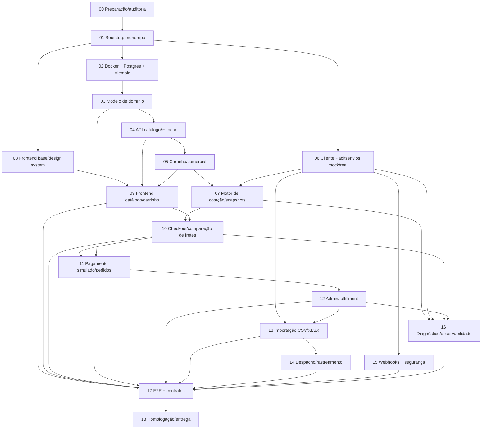

# Plano de execução e inventário de ambiente — freight-ecommerce-test (Prompt 00)

## 1. Inventário do ambiente (auditado em 08/10/2026)

| Item | Valor detectado | Observação |
|---|---|---|
| SO | Windows NT 10.0.26300 (win32), PowerShell 5.1.26100.9444 | Convenção de scripts: PowerShell (prompt 01) |
| Python | 3.11.15 (`python`); launcher `py` ausente | `pip` do PATH pertence a venv de terceiros (`hermes-agent`) — não instalar globalmente (R3) |
| Poetry | 2.4.0 | Gerenciador previsto no prompt 01 |
| Node / npm | v24.15.0 / 11.12.1 | Vite/React TS no frontend |
| Docker CLI | 29.4.1 (Compose v5.1.3) | **Daemon parado** (pipe `dockerDesktopLinuxEngine` inexistente) — bloqueia prompt 02 até iniciar o Docker Desktop (R2) |
| PostgreSQL host | sem `psql` no host (R4) | Banco somente via container |
| git | 2.54.0.windows.1 | |
| Portas checadas | 5432, 8000, 5173, 3000, 8080, 9000 — **livres** (nenhum LISTENING) | Propostas: Postgres 5432, backend FastAPI 8000, Vite 5173 (confirmar no prompt 01/02) |
| Diretório da auditoria | `E:\Softwares\joao` (contém `docs/reference/`) | Raiz definitiva do monorepo a definir no bootstrap (D13) |
| Repositório da loja | **ainda inexistente** — bootstrap é o prompt 01 | Nenhum `package.json`/`pyproject.toml` da loja criado até aqui |
| Prompt files | `00-…md` a `18-…md` + `README.md` na pasta pai | O README determina execução em ordem, um prompt por vez; `tests/` contém o verificador desta auditoria |
| Referência Packsenvios | `packslogenvios/` (Laravel, HEAD `f9c8906b`, 422 deleções na working tree) | Somente leitura; base divergente da documentada (R1) |
| Variáveis previstas (backend) | `FREIGHT_MODE=mock\|real`, `FREIGHT_BASE_URL`, `FREIGHT_API_KEY`, URL do Postgres, flags de modo | Chave **somente** no backend (D3); `.env.example` sem segredos (prompt 01) |

As versões, indisponibilidade do daemon e ausência de listeners nas seis portas foram reconferidas nesta revisão. Portas sem listener não garantem disponibilidade de bind: reservas/exclusões do Windows não foram verificadas e a checagem deve ser repetida antes de subir os serviços. As observações de Git/OpenAPI do snapshot são evidências da auditoria anterior, não verificações de um ambiente remoto.

### Variáveis necessárias / configuração futura

Não há `.env.example` da loja nem configuração implementada. Nomes abaixo são configuração **local proposta**, não campos adicionais da API Packsenvios; nenhum valor secreto foi lido.

| Nome / configuração | Uso | Origem / requisito |
|---|---|---|
| `FREIGHT_MODE` | Backend; default proposto `mock` | Prompt 06 |
| `FREIGHT_BASE_URL` | Backend real; URL base sem sufixo de API ou barra final | Prompt 06; referência L13 |
| `FREIGHT_API_KEY` | Segredo exclusivo do backend | Prompt 06; referência L14–L19 |
| `FREIGHT_COMPANY_ID`, `FREIGHT_LOCATION_ID` | Nomes locais propostos para UUIDs autorizados; unidade condicional | Prompt 06; campos contratuais `freight_company_id`/`freight_location_id`, L23–L27 |
| `FREIGHT_ORIGIN_POSTAL_CODE` | Origem explícita quando necessária; coerente com operação | Nome local proposto; L27/L59 |
| `DATABASE_URL` | Conexão da loja ao PostgreSQL local | Nome proposto para prompts 01–02; credenciais somente sintéticas |
| `POSTGRES_DB`, `POSTGRES_USER`, `POSTGRES_PASSWORD` | Configuração do container local | Proposta para prompt 02; não são credenciais Packsenvios |
| `VITE_API_BASE_URL` / origens CORS | Frontend aponta apenas à API local | Proposta para 01/08; nenhum Bearer Packsenvios em variáveis `VITE_*` |
| Segredo de webhook / `connection_id` | Configuração backend posterior, separada da chave de API | Nomes finais em 14–15; L244/L273 |

Dependências da loja: React, TypeScript, Vite, FastAPI, Pydantic, Ruff, ESLint, Vitest, Alembic e pytest são requisitos planejados, **não instalações verificadas nesta aplicação**. Nenhum manifesto da loja existe. `python -m pip --version` na auditoria anterior identificou uma venv de ferramenta; Poetry deverá criar ambiente próprio no bootstrap.

## 2. Premissas

1. Disponibilidade de homologação e emissão de credencial **não foram confirmadas**; não se presume sua ausência nem sua existência. Testes reais ficam `SKIP` até confirmação (D12).
2. Compra/pagamento/pedido são locais/simulados (D4). Cotação/consulta podem ser reais no checkout; importação/despacho/rastreio são fluxos separados condicionais (13–14).
3. `packslogenvios/` não será executado, migrado ou modificado.
4. Commits pequenos por feature; evidência de testes em cada etapa (README dos prompts).

## 3. Grafo de dependências entre prompts



### Dependências técnicas e sequência obrigatória

Executar **00 a 18 em ordem, um por vez**, conforme README L3/L10, revisando cada entrega antes de avançar. A coluna de paralelismo abaixo indica somente independência técnica potencial; não autoriza execução paralela nem salto de prompts. O próximo prompt é 01.

| Etapa | Depende de | Pode rodar em paralelo com | Gate de ambiente |
|---|---|---|---|
| 00 Auditoria (este prompt) | — | — | Nenhum |
| 01 Bootstrap | 00 | — | Nenhum |
| 02 Docker/DB | 01 | — | **Daemon Docker ativo** |
| 03 Domínio/persistência | 02 | 06 (cliente isolado) | Docker |
| 04 Catálogo API | 03 | 06, 08 | Docker |
| 05 Carrinho/comercial | 04 | 06, 08 | Docker |
| 06 Cliente Packsenvios | 01 | 03–05, 08 | Nenhum (mock); real = ambiente autorizado |
| 07 Motor de cotação | 05 + 06 | 08 | Docker |
| 08 Frontend base | 01 | 03–07 | Nenhum |
| 09 Frontend catálogo/carrinho | 08 + 04 + 05 | 06, 07 | Docker |
| 10 Checkout/fretes | 07 + 09 | — | Docker |
| 11 Pagamento/pedidos | 10 + 03 | — | Docker |
| 12 Admin/fulfillment | 11 | — | Docker |
| 13 Importação CSV/XLSX | 06 + 12 | 15, 16 | Docker; **modo real** = ambiente autorizado com filas |
| 14 Despacho/rastreio | 13 | 15, 16 | Idem 13 + conexão homologada |
| 15 Webhooks/segurança | 06 | 13, 14, 16 | Receptor local; entrega externa = homologação própria |
| 16 Diagnóstico | 07 + 06 + 10 + 12 | 13–15 | Docker |
| 17 E2E/contratos | 08–16 | — | Docker; reais = SKIP sem ambiente |
| 18 Homologação/entrega | 17 | — | Checklist GO/NO-GO com ambiente autorizado para itens reais |

### Critérios de bloqueio (não pular)

1. **02 sem daemon Docker ⇒ parar.** Não simular banco em memória para "passar" etapas dependentes sem registrar limitação.
2. **Nenhum prompt real (modo `real`, filas, webhooks externos, importação autenticada) executa sem ambiente autorizado + credencial** — registrar SKIP na matriz de evidências do 17/18.
3. **`manual_only` e `options: []`** devem ter cobertura de teste negativa já no 07/10 (seleção automática deve ser impossível).
4. **Bearer nunca no frontend** — verificação de vazamento no 08, 16 e 17.

## 4. Plano de verificações por etapa (resumo)

| Prompt | Verificações mínimas |
|---|---|
| 00 | Matriz traçável (roteado por linha do doc), inventário, riscos, plano — validação automatizada em `tests/validate_contract_matrix.py` |
| 01 | Instalação + lint + smoke test backend/frontend sem serviços externos |
| 02 | `docker compose up` com healthcheck; migração de teste; restart sem perda |
| 03 | Constraints, transições inválidas, rollback, snapshots |
| 04 | Preço em centavos, inativos, estoque insuficiente, payloads inválidos |
| 05 | Concorrência, recálculo, invalidação de cotação por mudança de itens/endereço |
| 06 | HTTP mock: `quoted`/`unavailable`/`fiscal_review`, timeout, replay, 422 divergente, redaction de token |
| 07 | Volumes divergentes, CEP inválido, replay idêntico, nova chave, estados `weight_only`/`manual_only` |
| 08–09 | Vitest/TL: navegação, carrinho, totais do servidor, estados de erro |
| 10 | Múltiplas ofertas, 401/403/422/429/503, troca de endereço, sem preço zero |
| 11 | Double submit, pagamento recusado, adulteração de frete, compensação de estoque |
| 12 | Máquina de estados local vs status externo; timeline auditável |
| 13 | Arquivo inválido, limite, lote pendente, linhas rejeitadas, dedupe, autorização |
| 14 | `dispatched`/`queued`/`uncertain`, conexão ausente, 202, eventos fora de ordem |
| 15 | HMAC válido/inválido, timestamp vencido, replay, ordem invertida |
| 16 | Redaction, correlation ID, ausência de vazamento em logs/frontend |
| 17 | Suíte completa + matriz PASS/FAIL/SKIP (sem alegar execução real) |
| 18 | Build/lint/testes/smoke; checklist GO/NO-GO; auditoria de segredos |

## 5. Saída esperada desta etapa (prompt 00)

- [x] Inventário de ambiente (§1) com versões, portas e variáveis.
- [x] `docs/architecture/contract-matrix.md` — 14 rotas, abilities, schemas, IDs, quotas, lacunas OpenAPI, pré-requisitos e pontos não verificados.
- [x] `docs/architecture/decisions.md` — D1–D13 + riscos R1–R12 + TODOs rastreáveis.
- [x] Este plano com dependências 00→18 e gates.
- [x] Validação automatizada da matriz: `python tests/validate_contract_matrix.py` (ver §6).

## 6. Comandos executados na auditoria

```text
Get-ChildItem / Get-Content        # leitura de prompts 00–18 e README
python --version; node --version; npm --version; docker --version; docker compose version; git --version; poetry --version
docker info                         # falhou: daemon parado
netstat -ano                        # portas 5432/8000/5173/3000/8080/9000 livres
git -C packslogenvios log/status/cat-file/show HEAD:routes/api.php   # base divergente, 7 rotas freight
openapi v1.json (paths freight/*)   # 7 rotas; order-imports ausentes
python tests/validate_contract_matrix.py   # confere 14 rotas da matriz contra o doc
```

Nenhum comando destrutivo, migration ou chamada HTTP externa foi executado.

### Revalidação do prompt 00

Comandos desta revisão:

- `python --version`, `node --version`, `npm --version`, `poetry --version`, `docker --version`, `docker compose version`, `git --version`: versões da seção 1 reconfirmadas.
- `docker info --format '{{.ServerVersion}}'`: falhou ao conectar ao pipe do Docker Desktop; nenhum container iniciado.
- `$PSVersionTable.PSVersion.ToString()` e `[System.Environment]::OSVersion.VersionString`: PowerShell/SO reconfirmados.
- `Get-NetTCPConnection -State Listen` filtrado para as seis portas: nenhum listener encontrado; nenhuma reserva de porta verificada.
- `Get-Command psql,py -ErrorAction SilentlyContinue`: comandos não encontrados no PATH.
- `python "E:\Softwares\joao\tests\validate_contract_matrix.py"`: **PASS**, 14 pares método/rota, abilities (incluindo as duas cumulativas de contratação) e linhas contratuais conferidas diretamente contra a tabela da fonte; três exemplos JSON da referência válidos. Todas as 14 rotas identificadas como não verificadas por HTTP.

O script citado na entrega anterior estava ausente ao iniciar esta revisão; foi recriado com comparação de conjuntos extraídos da fonte, sem lista manual de endpoints como autoridade. Lint/build/testes de aplicação: **não aplicáveis**, pois não há aplicação implementada nem ferramentas configuradas da loja. HTTP real, processamento assíncrono e entrega externa: **SKIP**, disponibilidade/autorização não confirmadas. A revisão documental manual abrange campos, unidades, IDs, quotas e lacunas; o verificador automático não comprova o funcionamento dos schemas no servidor.

**Próximo prompt:** 01 — Bootstrap do monorepo, após revisão desta entrega conforme README. O prompt 02 exige daemon Docker acessível; não é necessário ambiente de homologação para o bootstrap local.
